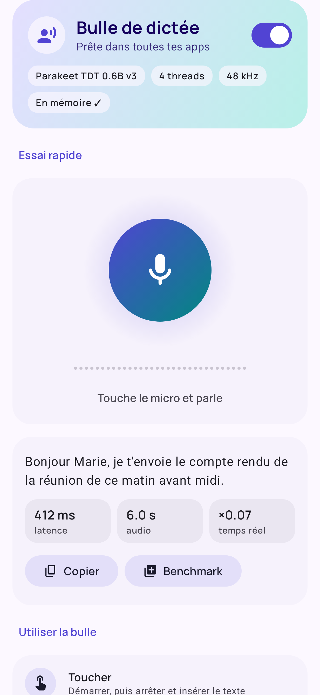
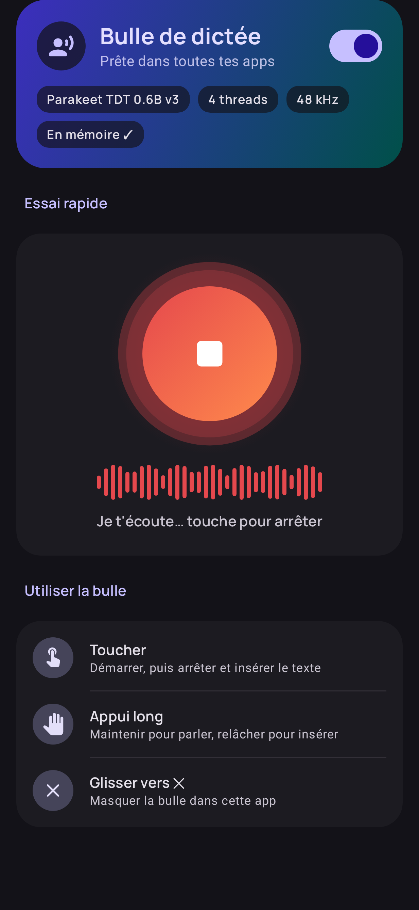
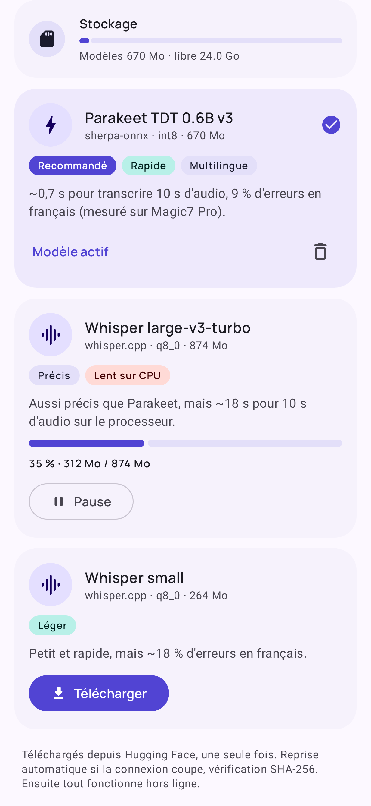
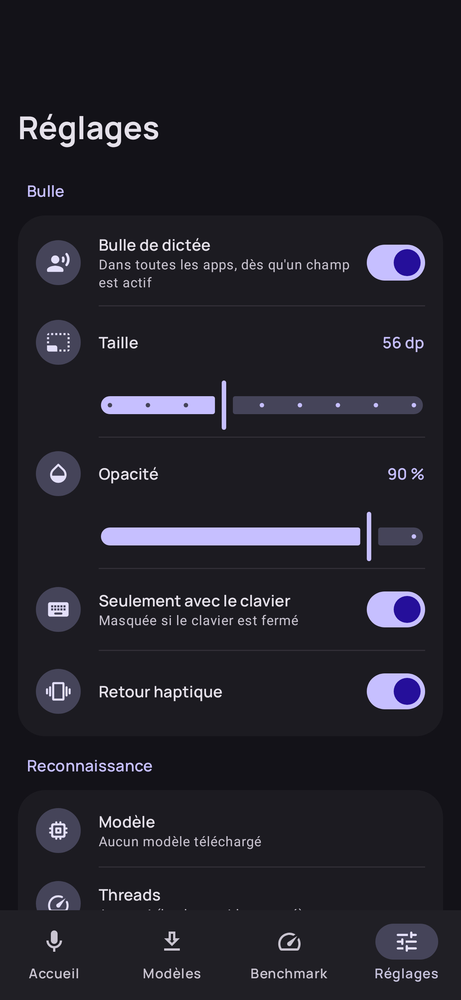

# Speech

<p>
  
  
  
  
</p>

Dictée vocale Android **100 % locale** (alternative libre à Wispr Flow) : aucun appel réseau
hors téléchargement initial des modèles. Cible : Honor Magic7 Pro (Snapdragon 8 Elite),
`arm64-v8a`, Android 10+ (minSdk 29, targetSdk 37).

**Télécharger** : [dernière version stable](https://github.com/Karelisio/Speech/releases/latest) ·
[build de développement](https://github.com/Karelisio/Speech/releases/download/dev-latest/speech.apk)

## Fonctions

| | |
|---|---|
| Bulle | Au-dessus du clavier dans toutes les apps. Toucher = démarrer/arrêter, appui long = maintenir pour parler, double tap = nettoyage IA on/off, glisser vers ✕ = masquer. |
| Insertion | Au curseur, sans écraser l'existant : canal de saisie du clavier (Android 13+), sinon `ACTION_SET_TEXT` + `SET_SELECTION`, sinon presse-papiers + `PASTE`. |
| Reconnaissance | Parakeet TDT 0.6B v3 int8 (sherpa-onnx, défaut), Whisper large-v3-turbo q8_0 / small q8_0 (whisper.cpp). |
| VAD | Silero : silences coupés (défaut) ou transcription **en direct** à chaque pause. |
| Nettoyage IA | Qwen 2.5 1.5B (défaut) / 3B Instruct Q4_0 via llama.cpp, GPU OpenCL (défaut) ou CPU. Prompt système en cache KV, début du texte pré-calculé pendant l'enregistrement, décodage spéculatif par recopie de la dictée. Garde-fous : 1,5 × l'entrée, aucun mot ajouté ou remplacé, aucune négation retirée. |
| Dictionnaire | Prompt Whisper, prompt du nettoyage, correction des variantes proches. |
| Historique | 50 dernières dictées, brut + final, copie en un tap. |
| Benchmark | Modèles × threads × modes VAD × accélérateurs, latence après stop, RTF, RAM, WER avant/après IA, endurance 100 dictées, export Markdown. |
| Système | Assistant d'autorisations (guide MagicOS), mise à jour in-app, libération de la RAM après inactivité, journal exportable. |

## Mesures (Magic7 Pro)

| Config | 10 s d'audio → texte | WER |
|---|---|---|
| Parakeet TDT 0.6B v3 int8, 4 threads | 0,69 s | 9,4 % |
| Whisper large-v3-turbo q8_0, 6 threads | 17,8 s | 9,4 % |
| Whisper small q8_0, ctx dynamique | 0,9 s | 18 % |

Benchmark 1.0.2 (5 clips, 48 kHz, médiane de 3) :

| Parakeet | 10 s → texte | WER |
|---|---|---|
| 4 threads, CPU, silences coupés (défaut) | 0,72 s | 10,1 % |
| 4 threads, bloc entier | 0,74 s | 11,4 % |
| 2 / 6 threads | 0,92 / 0,84 s | 10,1 % |
| NNAPI / XNNPACK (4 threads) | 0,75 / 0,73 s | 10,1 % |

NNAPI et XNNPACK n'apportent rien : CPU gardé. Nettoyage Qwen 1.5B : 1,44 s en moyenne sur GPU
contre 2,30 s sur CPU (GPU par défaut). Endurance 100 dictées + nettoyage : dérive de 15 Mo.

Capture micro : 48 kHz + décimation Speech (le rééchantillonnage 16 kHz du téléphone duplique
~18 % des échantillons).

## Architecture

- `app/` — Compose, services (accessibilité, micro, téléchargements), pipeline de dictée
  (`dictation/`), moteurs STT (`stt/`), VAD (`vad/`), nettoyage (`clean/`), benchmark (`bench/`).
- `app/src/main/cpp` — JNI whisper.cpp (sous-module v1.9.5).
- `llm/` — JNI llama.cpp CPU (sous-module b11345) ; `llmgpu/` — même JNI avec le backend OpenCL
  Adreno, chargé à la demande.
- Natif : `-O3 -march=armv8.2-a+dotprod+fp16+i8mm`, sans OpenMP, symboles masqués
  (`--exclude-libs,ALL`), toujours compilé en Release.
- Release : R8 complet (+ retrait des vérifications de nullité Kotlin), ressources réduites,
  `.so` non compressés alignés 16 Ko, profils ART de Compose installés au premier lancement.

## Captures d'écran (sans téléphone)

Rendu des écrans sur le JVM (Robolectric + Roborazzi), exclu de la CI :

```bash
./gradlew -Pscreenshots testDebugUnitTest --tests '*Screenshots*'   # → app/build/screenshots/
```

## Build

```bash
git submodule update --init --recursive
./gradlew assembleRelease
```

La CI (`.github/workflows/android.yml`) vérifie le catalogue de modèles
(`scripts/check_models.py`), lance les tests et publie l'APK : chaque push met à jour la
pré-release `dev-latest` (utilisée par la mise à jour in-app) ; la première build d'une nouvelle
version (fichier `VERSION`) crée la release stable `vX.Y.Z` avec les notes de `docs/release-notes/`.

### Signature

Sans secrets, l'APK est signé avec la clé de dev commitée (`app/dev.keystore`) pour que les
mises à jour s'installent par-dessus. Pour une clé privée, ajouter dans les secrets GitHub :
`KEYSTORE_BASE64`, `KEYSTORE_PASSWORD`, `KEY_ALIAS`, `KEY_PASSWORD`
(changer de clé impose une désinstallation, donc un nouveau téléchargement des modèles).

## Licences des composants

whisper.cpp, llama.cpp, onnxruntime, Silero VAD : MIT · sherpa-onnx : Apache 2.0 ·
Parakeet TDT v3 : CC-BY-4.0 · Whisper : MIT · Qwen 2.5 1.5B : Apache 2.0 ·
Qwen 2.5 3B : Qwen Research License (usage non commercial) · Manrope : OFL 1.1.
